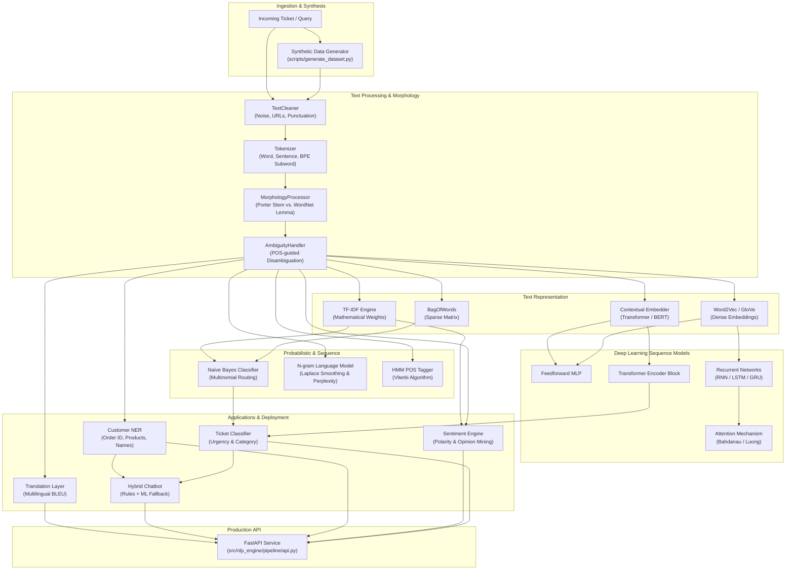

# System Architecture: End-to-End Intelligent Customer Support & Sentiment Analytics

> **Domain:** Customer Support Operations, Issue Categorization, Automated Triage, and Conversational Assistance  
> **Package:** `nlp_engine`

---

## 🏗️ Architectural Overview

The system processes incoming customer communications (emails, live chat messages, tickets, reviews) through five sequential stages, transforming raw unstructured natural language into structured analytical insights, automated ticket resolutions, and routing decisions.

---

## 📦 Data Schemas & Contracts

### 1. Ingestion Record Schema (`data/raw/customer_tickets.csv`)
| Field | Type | Description |
| :--- | :--- | :--- |
| `ticket_id` | String | Unique identifier (e.g., `TCK-10492`) |
| `customer_name` | String | Name of customer |
| `email` | String | Customer contact address |
| `subject` | String | Brief ticket summary |
| `body` | String | Full message / inquiry text |
| `category` | String | Target category (e.g., `Billing & Invoicing`, `Technical Support`) |
| `urgency` | String | Priority level (`Low`, `Medium`, `High`, `Critical`) |
| `sentiment` | String | Ground truth polarity (`Positive`, `Neutral`, `Negative`) |
| `is_spam` | Integer | Binary flag (`0` legitimate, `1` spam) |
| `entities` | JSON/String | Extracted entities dictionary (`order_id`, `product`, `date`) |

### 2. FastAPI Request & Response Contracts (`src/nlp_engine/pipeline/api.py`)
- **`POST /api/v1/predict/ticket`**: Classifies category, urgency, spam risk, and sentiment.
- **`POST /api/v1/sentiment`**: Extracts sentence-level polarity and subjective tone.
- **`POST /api/v1/ner`**: Extracts customer entities (`ORDER_ID`, `PRODUCT`, `DATE`, `PERSON`).
- **`POST /api/v1/chat`**: Generates a conversational resolution using rule tree or ML intent matching.
- **`GET /health`**: Microservice health, model status, and version telemetry.
